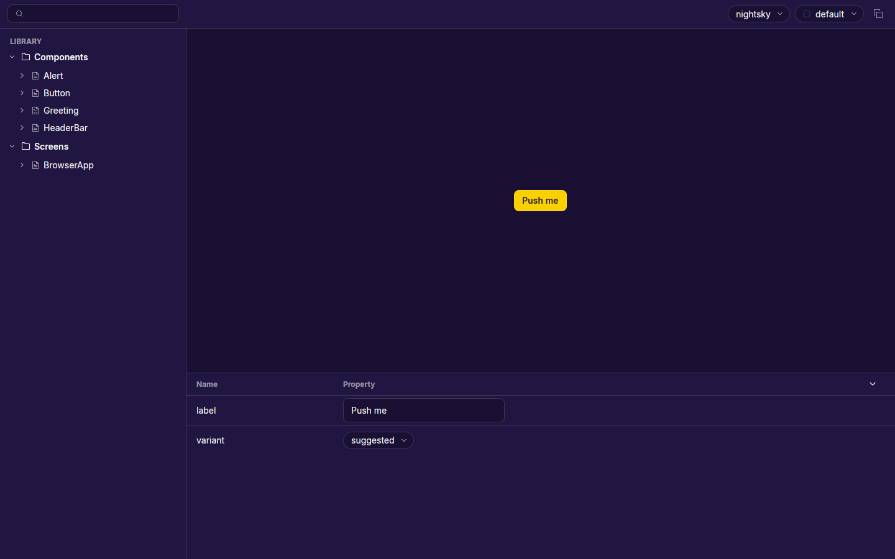

# storybook

A Storybook-style component tooling for **GPU-rendered React UIs** built on
[`@gpuix/react`](https://www.npmjs.com/package/@gpuix/react). It discovers
CSF-format stories, renders them to PNG screenshots via the `@gpuix/native`
test renderer, and launches an interactive GPU browser for exploring components
live.



## Features

- **Story discovery** — walks `src/**/*.tsx` and picks up CSF modules
  (default `Meta` export + named story exports, as functions or objects).
- **PNG rendering** — every story is rendered headlessly through
  `@gpuix/native`'s `TestRenderer` into a PNG next to its source file.
- **Interactive browser** — a GPU-rendered Storybook-like app with story
  sidebar, search, live args controls, and copy-to-clipboard of story source.
- **Adwaita theming** — stories are wrapped in `AdwaitaProvider`
  (`adwaita-gpuix`) by default via the preview module.

## Setup

From the workspace root:

```sh
cd gpuix-apps
bun install
```

## Usage

### Dev browser (interactive)

```sh
bun run dev            # equivalent to: bun --hot src/dev.ts
```

Launches the interactive browser (1440×900) with all discovered stories in
hot reload mode. `bun --hot` re-runs the entry point when files change and
`render()` remounts the app on the same native window, so edits to stories or
the browser UI apply live without relaunching.

### Render all stories to PNG

```sh
bun run src/cli.ts [projectRoot] [flags]
```

| Flag            | Description                                                   |
| --------------- | ------------------------------------------------------------- |
| `--only <term>` | Filter stories by name/title/file (also `STORYBOOK_ONLY` env) |
| `--dry-run`     | List discovered stories without rendering                     |
| `--browser`     | Launch the interactive browser instead of rendering           |

Each rendered story writes `<story-file-dir>/<Title>/<StoryName>.png`
(next to the `.stories.tsx` file), at `parameters.width`/`height`
(default 640×480), with an optional `settleMs` delay before capture.

### Render a single story

```sh
bun run src/cli.ts --one <projectRoot> <storyFile> <title> <name> <previewModule>
```

### Unit tests

```sh
bun test              # runs vitest
bun run vitest        # vitest in watch mode
```

## Writing stories

A story module exports a `Meta` as `default` plus named stories:

```tsx
import { defineMeta, defineStory } from "storybook";
import { Button, type ButtonProps } from "adwaita-gpuix";

export default defineMeta({
  title: "Adwaita/Button",
  component: Button,
  parameters: { width: 620, height: 420 },
  args: { label: "Hello" }, // component-level baseline for the controls panel
  argTypes: {
    variant: { options: ["default", "suggested", "destructive"] },
  },
});

// Overview: every variant/state at once (the visual-regression surface).
export function Overview() {
  return (
    <>
      <Button label="Default" />
      <Button label="Suggested" variant="suggested" />
      <Button label="Destructive" variant="destructive" />
    </>
  );
}

// Per-story args override only what differs from the meta baseline.
export const Playground = defineStory<Pick<ButtonProps, "label" | "disabled">>({
  args: { label: "Click me", disabled: false },
});
```

Notes:

- Stories can be **functions** (render fn) or **objects**
  (`defineStory` / plain `StoryObj` with `args`, `render`, `parameters`,
  `decorators`).
- Story exports are **UpperCamelCase**; the export name becomes the sidebar
  entry and the PNG filename.
- `parameters.width`, `parameters.height`, `parameters.settleMs` control the
  capture canvas size and the time the renderer is advanced before the
  screenshot (use for async/animated content).
- `argTypes` `options`/`control` drive the args controls in the browser app's
  property panel.
- Preview decorators come from `.storybook/main.tsx`, e.g.
  the `AdwaitaProvider` wrapper.

## Best Practices

Adapted from the
[official Storybook writing-stories guide](https://storybook.js.org/docs/writing-stories)
to the GPU renderer — web-Storybook extras (MDX, `autodocs`, actions, play
functions, a11y addon) do not exist here; see the notes at the end of this
section.

### File layout

- One story file per component: `ComponentName.stories.tsx` directly next
to `ComponentName.tsx` (no separate `stories/` tree).
- Component stories live in `src/components/`, app/screen stories in
  `src/screens/`.

### Titles & sidebar grouping

- `title` is `"Group/Component"`: the first segment is a sidebar section,
  the last is the component entry (e.g. `Components/Button`,
  `Screens/BrowserApp`).
- Group by domain — `Components`, `Screens` — and keep groups flat rather
  than deeply nested.

### Story exports

- Name story exports in **UpperCamelCase** (`Overview`, `Default`, `Empty`);
  the export name becomes the sidebar entry and the PNG filename.
- Every component file starts with an **`Overview`** story that renders
  every variant/state at once — it doubles as the quick visual-regression
  surface for the PNG capture.
- Document edge cases as their own stories: `Empty`, `Error`, `Loading`.
- Function stories (plain `export function`, no `defineStory`) may carry
  local state (`useState`) for interactive demos in the browser app.

### Args

- Give `meta` a meaningful component-level `args` baseline so the controls
  panel starts from a working state.
- Per-story `args` override only what differs; compose from the baseline
  (`args: { ...base, label: "…" }`) rather than repeating it.

### Controls

`argTypes` `options`/`control` drive the args controls in the browser
app's property panel:

| `control` | Use for                        |
| --------- | ------------------------------ |
| `select`  | enums with many options       |
| `radio`   | enums with 2–4 options        |
| `boolean` | true/false toggles            |
| `text`    | string inputs                 |
| `number`  | numeric values                |

### Parameters

- `parameters.width`/`height` (meta or story) set the capture canvas size.
- `parameters.settleMs` advances the renderer before the screenshot; use it
  for async/animated content that must settle first.

### Decorators

- Local: `decorators` on `meta` wrap only that component's stories
  (e.g. a `StoryThemeProvider` with a specific scheme/accent).
- Global: `.storybook/main.tsx` exports `decorators` applied to every
  story (e.g. the `AdwaitaProvider` wrapper).

### Testing

- No play functions: interaction behavior (click, form submit, error
  flows) is verified with `bun test` (vitest) unit tests, not story play
  functions.
- Visual behavior is verified by the PNG captures (`bun run src/cli.ts`),
  one per story, next to its source file.

## Package API

The package exports (`src/index.ts`) the building blocks for embedding:

- `runStories(stories, projectRoot, opts)` — render a list of `StoryDef`s
- `renderStory` / `renderWithRetry` — render helpers
- `decodePng` / `encodePng` — PNG codec
- `defineMeta`, `defineStory`, CSF types (`Meta`, `StoryObj`, `Args`, …)
