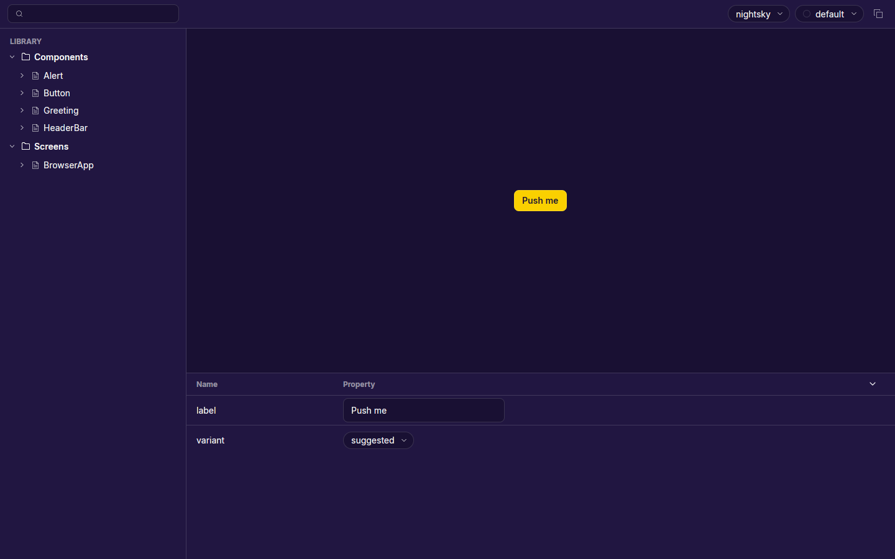

# storybook

A Storybook-style component tooling for **GPU-rendered React UIs** built on
[`@gpuix/react`](https://www.npmjs.com/package/@gpuix/react). It discovers
CSF-format stories, renders them to PNG screenshots via the `@gpuix/native`
test renderer, and launches an interactive GPU browser for exploring components
live.



## Features

- **Story discovery** — walks `src/**/*.tsx` and picks up CSF modules
  (default `Meta` export + named story exports, as functions or objects).
- **PNG rendering** — every story is rendered headlessly through
  `@gpuix/native`'s `TestRenderer` into a PNG next to its source file.
- **Interactive browser** — a GPU-rendered Storybook-like app with story
  sidebar, search, live args controls, and copy-to-clipboard of story source.
- **Adwaita theming** — stories are wrapped in `AdwaitaProvider`
  (`adwaita-gpuix`) by default via the preview module.

## Setup

From the workspace root:

```sh
cd gpuix-apps
bun install
```

### Capture requires a test-support build of `@gpuix/native`

PNG capture renders through `@gpuix/native/testing` (`TestGpuixRenderer`),
which exists only in a build with the `test-support` feature. The npm Linux
artifacts (`@gpuix/native-linux-x64-gnu`) are built `--no-default-features`, so
they ship a stub and `hasTestGpuixRenderer()` is false; on Linux this package
therefore pins `@gpuix/native` to the local `file:../../knoopx/gpuix/packages/native`
build, which carries the real Linux test renderer.

That build's ELF RUNPATH names nix-store lib dirs from its build environment.
When those exact paths are GC'd, `libfontconfig.so.1` / `libfreetype.so.6` stop
resolving, the binding's `dlopen` fails, and the napi loader silently falls back
to the npm stub — every story then dies with "TestGpuixRenderer is macOS and
Windows only", which reads like a platform limit but is a missing library.

`src/lib/gpuix-libs.ts` fixes that at CLI start (`fixNativeLoader` in
`src/cli.ts`): it reads the bindings' own RUNPATH, finds the NEEDED libs that do
not resolve, re-resolves them from the store (the package named by a RUNPATH
entry first, else the newest store package of that name), appends those `lib`
dirs to the **existing** `LD_LIBRARY_PATH`, and re-execs the CLI once so the
change is visible to the dynamic loader (`LD_LIBRARY_PATH` is read at exec time,
so setting it in a running process cannot fix that process's own `dlopen`).
`GPUIX_LIBS_RESOLVED=1` marks the re-exec so children inherit the fix and do not
exec again. Nothing is a hardcoded store path.

When no test-support binding is loaded, the CLI says so once — bindings
inspected, dirs appended, unresolved libs, the resulting `LD_LIBRARY_PATH` —
instead of failing every story with the stub's message.

## Usage

### Dev browser (interactive)

```sh
bun run dev            # equivalent to: bun --hot src/dev.ts
```

Launches the interactive browser (1440×900) with all discovered stories in
hot reload mode. `bun --hot` re-runs the entry point when files change and
`render()` remounts the app on the same native window, so edits to stories or
the browser UI apply live without relaunching.

### Render all stories to PNG

```sh
bun run src/cli.ts [projectRoot] [flags]
```

| Flag            | Description                                                   |
| --------------- | ------------------------------------------------------------- |
| `--only <term>` | Filter stories by name/title/file (also `STORYBOOK_ONLY` env) |
| `--dry-run`     | List discovered stories without rendering                     |
| `--browser`     | Launch the interactive browser instead of rendering           |

Each rendered story writes `<story-file-dir>/<Title>/<StoryName>.png`
(next to the `.stories.tsx` file), at `parameters.width`/`height`
(default 640×480), with an optional `settleMs` delay before capture.

### Render a single story

```sh
bun run src/cli.ts --one <projectRoot> <storyFile> <title> <name> <previewModule>
```

### Unit tests

```sh
bun test              # runs vitest
bun run vitest        # vitest in watch mode
```

## Writing stories

A story module exports a `Meta` as `default` plus named story exports. Every
file starts with the same meta shape — a `title` (`"Group/Component"`), the
`component` under test, and `parameters` holding the **default capture
canvas** for the component. The snippets below use a stand-in `Chip` so they
stay illustrative; a real module is
`adwaita-gpuix/src/components/Button.stories.tsx`:

```tsx
import { defineMeta, defineStory } from "storybook";
import { Labeled } from "./common";
import { Column } from "./Box";
import { Chip } from "./Chip";

export default defineMeta({
  title: "Adwaita/Chip", // "Group/Component" — also the PNG path
  component: Chip,
  parameters: { width: 360, height: 180 }, // default canvas for the component
});
```

### Pure stories — `defineStory` objects

A story whose body just renders components (no top-level hook) is a
`defineStory` object:

```tsx
export const kinds = defineStory({
  render: () => (
    <Column gap={12} align="center">
      <Labeled caption="resting">
        <Chip label="Draft" />
      </Labeled>
      <Labeled caption="selected">
        <Chip label="Merged" selected />
      </Labeled>
    </Column>
  ),
});
```

`parameters` is included **only when the canvas differs from the meta
default** — omit it otherwise and the story inherits
`meta.parameters.width`/`height`.

### Themed stories — function exports

A story that calls `useAdwaita()` at the top level for inline styles must be
a **function export** (see the hook constraint below). Attach `parameters`
to the export when the canvas differs from the meta default:

```tsx
export function statusDots() {
  const t = useAdwaita();
  return (
    <Row gap={16} align="start">
      <Labeled caption="success">
        <div
          style={{
            width: 12,
            height: 12,
            borderRadius: 6,
            backgroundColor: t.colors.success,
          }}
        />
      </Labeled>
      <Labeled caption="destructive">
        <div
          style={{
            width: 12,
            height: 12,
            borderRadius: 6,
            backgroundColor: t.colors.destructive,
          }}
        />
      </Labeled>
    </Row>
  );
}
statusDots.parameters = { width: 528, height: 120 };
```

Interactive stories using `useState` are function exports the same way.

### The hook constraint

An object story's `render` is **invoked directly** as a plain function — the
framework calls `render(args, context)` while building the element tree; it
does not mount it as a React component. A top-level `useAdwaita()` /
`useState` inside such a `render` is therefore an invalid hook call and
breaks the story. Function exports, by contrast, are mounted as real
components, so hooks work at the top level of the function body.

Rule of thumb:

- body just renders components → `defineStory` object;
- top-level `useAdwaita()` (themed inline styles) → function export;
- `useState` (interactive demo) → function export.

### Layout: `Row` / `Column`, not hand-rolled flex

Row/column layout uses the library's `Row` / `Column` components (from the
app's `Box` module) — do **not** hand-roll
`<div style={{ display: "flex", ... }}>` wrappers. The mapping from raw
flexbox:

| Raw flexbox                | `Row` / `Column` prop |
| -------------------------- | --------------------- |
| `alignItems: "flex-start"` | `align="start"`       |
| `alignItems: "center"`     | `align="center"`      |
| `alignItems: "flex-end"`   | `align="end"`         |
| (omitted = stretch)        | omit `align`          |
| `justifyContent: …`        | `justify="…"`         |

Keep a raw `<div>` only for a **functional box** — one that paints a
background/border, is `position: "relative"`, or carries a click handler.

### Captions: the shared `Labeled` helper

Caption+content cells use the shared `Labeled` helper (from the app's
`common` module) — never redefine it per file:

```tsx
<Labeled caption="sm (28)">
  <Button size="sm" label="Save" />
</Labeled>
```

### Notes

- Story export names are **stable** — the export name becomes the sidebar
  entry and the PNG filename (`<story dir>/<Title>/<name>.png`); don't
  rename stories casually.
- Story **data** that drives the component belongs in `args` (meta-level
  baseline, per-story overrides for what differs); **layout/showcase
  structure** belongs in the `render` body.
- `parameters.settleMs` advances the renderer before capture — use it for
  async/animated content.
- `argTypes` `options`/`control` drive the args controls in the browser
  app's property panel.
- Preview decorators come from `.storybook/main.tsx`, e.g. the
  `AdwaitaProvider` wrapper.

## Best Practices

Adapted from the
[official Storybook writing-stories guide](https://storybook.js.org/docs/writing-stories)
to the GPU renderer — web-Storybook extras (MDX, `autodocs`, actions, play
functions, a11y addon) do not exist here; see the notes at the end of this
section.

### File layout

- One story file per component: `ComponentName.stories.tsx` directly next
  to `ComponentName.tsx` (no separate `stories/` tree).
- Component stories live in `src/components/`, app/screen stories in
  `src/screens/`.

### Titles & sidebar grouping

- `title` is `"Group/Component"`: the first segment is a sidebar section,
  the last is the component entry (e.g. `Components/Button`,
  `Screens/BrowserApp`).
- Group by domain — `Components`, `Screens` — and keep groups flat rather
  than deeply nested.

### Story exports

- Name story exports in **lowerCamelCase** (`variants`, `sizes`, `empty`,
  `photoBadge`); the export name becomes the sidebar entry and the PNG
  filename.
- **Keep export names stable** — they are the PNG filenames and sidebar
  entries, so renaming a story orphans its previous captures.
- Start each component file with the primary showcase story (e.g.
  `variants` / `showcase`), then document edge cases as their own stories:
  `empty`, `disabled`, `loading`.
- A story is a **`defineStory` object** when its body just renders
  components; a **function export** when it calls `useAdwaita()` at the top
  level (themed inline styles) or uses `useState` (interactive) — see the
  hook constraint in _Writing stories_.

### Layout & captions

- Row/column layout comes from the `Row` / `Column` components (the app's
  `Box` module) — never hand-roll
  `<div style={{ display: "flex", ... }}>` wrappers. Map
  `alignItems: "flex-start" → align="start"`, `"center" → "center"`,
  `"flex-end" → "end"`; omit `align` for stretch; `justifyContent` →
  `justify`.
- Keep a raw `<div>` only for a functional box (paints a background/border,
  is `position: "relative"`, or has a click handler).
- Caption+content cells use the shared `Labeled` helper (the app's `common`
  module) — never redefine it per file.

### Args

- Story data that drives the component belongs in `args`: a meaningful
  meta-level `args` baseline so the controls panel starts from a working
  state, with per-story `args` overriding only what differs (compose from
  the baseline rather than repeating it).
- Layout/showcase structure belongs in the `render` body, not in `args`.

### Controls

`argTypes` `options`/`control` drive the args controls in the browser
app's property panel:

| `control` | Use for                 |
| --------- | ----------------------- |
| `select`  | enums with many options |
| `radio`   | enums with 2–4 options  |
| `boolean` | true/false toggles      |
| `text`    | string inputs           |
| `number`  | numeric values          |

### Parameters

- `meta.parameters.width`/`height` set the component's **default** capture
  canvas; a story's `parameters` override them only when the canvas differs
  (object stories via the `defineStory` field, function exports via
  `<name>.parameters`).
- `parameters.settleMs` advances the renderer before the screenshot; use it
  for async/animated content that must settle first.

### Decorators

- Local: `decorators` on `meta` wrap only that component's stories
  (e.g. a `StoryThemeProvider` with a specific scheme/accent).
- Global: `.storybook/main.tsx` exports `decorators` applied to every
  story (e.g. the `AdwaitaProvider` wrapper).

### Testing

- No play functions: interaction behavior (click, form submit, error
  flows) is verified with `bun test` (vitest) unit tests, not story play
  functions.
- Visual behavior is verified by the PNG captures (`bun run src/cli.ts`),
  one per story, next to its source file.

## Package API

The package exports (`src/index.ts`) the building blocks for embedding:

- `runStories(stories, projectRoot, opts)` — render a list of `StoryDef`s
- `renderStory` / `renderWithRetry` — render helpers
- `decodePng` / `encodePng` — PNG codec
- `defineMeta`, `defineStory`, CSF types (`Meta`, `StoryObj`, `Args`, …)
